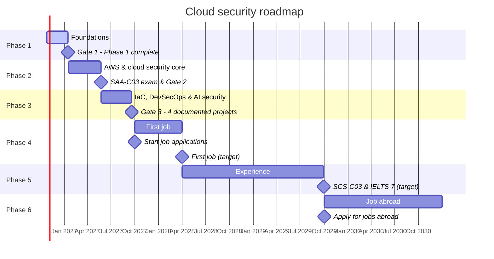

# Cloud Security Journey

> From fundamentals to a global Cloud Security Engineer role, learning in public one day at a time.

**Dipro** · CSE student at Metropolitan University, Sylhet, Bangladesh  
Focus: AWS · Cloud security · DevSecOps

   

_Last updated 25 Oct 2026._

## Now

- **Current:** Day 1 · Setup (in progress)
- **Phase 1:** 0 of 84 days complete (0%)
- **Next milestone:** 13 Nov 2026 · OWASP Dhaka online meetup

## At a glance

| Metric | Done | Target | Progress |
| --- | ---: | ---: | --- |
| Phase 1 days complete | 0 | 84 | `░░░░░░░░░░` 0% |
| Hours logged | 0 | 210 | `░░░░░░░░░░` 0% |
| Gate 1 criteria met | 0 | 7 | `░░░░░░░░░░` 0% |
| Blog posts published | 0 | 6 | `░░░░░░░░░░` 0% |
| LinkedIn posts | 0 | 12 | `░░░░░░░░░░` 0% |
| Bandit levels completed | 0 | 26 | `░░░░░░░░░░` 0% |
| Daily quizzes taken | 0 | 84 | `░░░░░░░░░░` 0% |
| Mentor / senior conversations | 0 | 3 | `░░░░░░░░░░` 0% |
| Community events attended | 0 | 4 | `░░░░░░░░░░` 0% |

## Roadmap

| Phase | Dates | Focus | Gate to pass | Progress |
| --- | --- | --- | --- | --- |
| 1. Foundations | 26 Oct 2026 – 17 Jan 2027 | Linux, networking, Python, Git, security fundamentals | Log analyzer on GitHub + 12 weeks of daily logs | 0% |
| 2. AWS & cloud security core | 18 Jan 2027 – 23 May 2027 | IAM, VPC, S3, KMS, logging, detection | Pass SAA-C03 + Project 1 (secure AWS baseline) | 0% |
| 3. IaC, DevSecOps & AI security | 24 May 2027 – 19 Sep 2027 | Terraform, CI/CD, Docker, Kubernetes, LLM security | 4 documented projects on GitHub | 0% |
| 4. First job | 1 Oct 2027 – 31 Mar 2028 | Cloud/DevOps or SOC role, local or remote | Job offer in hand | 0% |
| 5. Experience | 1 Apr 2028 – 30 Sep 2029 | Production work, AWS SCS-C03, IELTS | About 2 years of experience | 0% |
| 6. Job abroad | 1 Oct 2029 – 31 Dec 2030 | Germany, the Netherlands or the Gulf | Visa and job | 0% |



## Phase 1 · daily progress

🟩 done · 🟨 in progress · ⬜ to do · ⭐ community event

| Week | Mon | Tue | Wed | Thu | Fri | Sat | Sun | Done | Focus |
| --- | :-: | :-: | :-: | :-: | :-: | :-: | :-: | ---: | --- |
| W1 | 🟨 1 | ⬜ 2 | ⬜ 3 | ⬜ 4 | ⬜ 5 | ⬜ 6 | ⬜ 7 | 0/7 | Setup, Git & Linux basics |
| W2 | ⬜ 8 | ⬜ 9 | ⬜ 10 | ⬜ 11 | ⬜ 12 | ⬜ 13 | ⬜ 14 | 0/7 | Processes, SSH, logs & Bash |
| W3 | ⬜ 15 | ⬜ 16 | ⬜ 17 | ⬜ 18 | ⬜ 19 ⭐ | ⬜ 20 | ⬜ 21 | 0/7 | Linux security & first mini project |
| W4 | ⬜ 22 | ⬜ 23 | ⬜ 24 | ⬜ 25 | ⬜ 26 | ⬜ 27 | ⬜ 28 | 0/7 | Networking I: fundamentals |
| W5 | ⬜ 29 | ⬜ 30 | ⬜ 31 | ⬜ 32 | ⬜ 33 | ⬜ 34 | ⬜ 35 | 0/7 | Networking II: the security view |
| W6 | ⬜ 36 | ⬜ 37 | ⬜ 38 | ⬜ 39 | ⬜ 40 | ⬜ 41 | ⬜ 42 | 0/7 | Python I |
| W7 | ⬜ 43 | ⬜ 44 | ⬜ 45 | ⬜ 46 | ⬜ 47 ⭐ | ⬜ 48 ⭐ | ⬜ 49 | 0/7 | Python II: Python for security |
| W8 | ⬜ 50 | ⬜ 51 | ⬜ 52 | ⬜ 53 | ⬜ 54 | ⬜ 55 | ⬜ 56 | 0/7 | Log analyzer project |
| W9 | ⬜ 57 | ⬜ 58 | ⬜ 59 | ⬜ 60 | ⬜ 61 | ⬜ 62 | ⬜ 63 | 0/7 | Git deep dive & first CI |
| W10 | ⬜ 64 | ⬜ 65 | ⬜ 66 | ⬜ 67 | ⬜ 68 | ⬜ 69 | ⬜ 70 | 0/7 | Security fundamentals |
| W11 | ⬜ 71 | ⬜ 72 | ⬜ 73 | ⬜ 74 | ⬜ 75 ⭐ | ⬜ 76 | ⬜ 77 | 0/7 | Cloud & first AWS account |
| W12 | ⬜ 78 | ⬜ 79 | ⬜ 80 | ⬜ 81 | ⬜ 82 | ⬜ 83 | ⬜ 84 | 0/7 | Review & Gate 1 |

### This week · W1 · Setup, Git & Linux basics

| Day | Date | Topic | Status | Log |
| ---: | --- | --- | --- | --- |
| 1 | 26 Oct 2026 | Setup | 🟨 in progress | — |
| 2 | 27 Oct 2026 | Git fundamentals | ⬜ to do | — |
| 3 | 28 Oct 2026 | Linux filesystem | ⬜ to do | — |
| 4 | 29 Oct 2026 | Working with files | ⬜ to do | — |
| 5 | 30 Oct 2026 | Permissions & users | ⬜ to do | — |
| 6 | 31 Oct 2026 | Text processing | ⬜ to do | — |
| 7 | 1 Nov 2026 | Review | ⬜ to do | — |

## Gate 1 checklist

All of these must be true before Phase 2 starts.

- [ ] Completed Bandit levels 0–25
- [ ] Can split 10.0.0.0/16 into four /24 subnets from memory
- [ ] Can explain DNS and TLS in English in 2 minutes
- [ ] Log analyzer v1.0 on GitHub with README, tests and CI
- [ ] 6 blog posts and at least 10 LinkedIn posts published
- [ ] AWS account secured: root MFA, budget alert, no idle resources
- [ ] Talked with at least one mentor or senior

## Milestones

| Date | Milestone | Type | Status |
| --- | --- | --- | --- |
| 13 Nov 2026 | OWASP Dhaka online meetup | Community | ⏳ upcoming |
| 15 Nov 2026 | Message 2 seniors on LinkedIn | Community | ⏳ upcoming |
| 29 Nov 2026 | Book first ADPList mentor session | Community | ⏳ upcoming |
| 11 Dec 2026 | OWASP Dhaka online meetup | Community | ⏳ upcoming |
| 12 Dec 2026 | AWS Community Day Bangladesh | Community | ⏳ upcoming |
| 8 Jan 2027 | OWASP Dhaka online meetup | Community | ⏳ upcoming |
| 17 Jan 2027 | Gate 1 - Phase 1 complete | Gate | ⏳ upcoming |
| 23 May 2027 | SAA-C03 exam & Gate 2 | Exam | ⏳ upcoming |
| 19 Sep 2027 | Gate 3 - 4 documented projects | Gate | ⏳ upcoming |
| 1 Oct 2027 | Start job applications | Career | ⏳ upcoming |
| 31 Mar 2028 | First job (target) | Career | ⏳ upcoming |
| 30 Sep 2029 | SCS-C03 & IELTS 7 (target) | Exam | ⏳ upcoming |
| 1 Oct 2029 | Apply for jobs abroad | Career | ⏳ upcoming |

## Daily logs

_No logs yet. Day 1 is in progress._

## Repository structure

```text
cloud-security-journey/
├── README.md              # this dashboard (generated)
├── logs/                  # one learning log per day: day-01.md, day-02.md, ...
├── progress/              # progress data the dashboard is built from
└── scripts/
    └── build_readme.py    # regenerates README.md from progress/
```

This README is generated from `progress/*.json` by `scripts/build_readme.py`. To update it, edit the data and run `python3 scripts/build_readme.py`.
